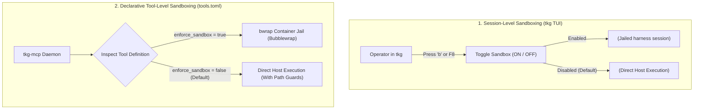

# Configurable Sandboxing & Security Jails

Security in `TorqKage` operates on a **default-deny capability model**. Sandboxing is not hardcoded to force every command into a container; rather, it is a **flexible, opt-in mechanism** configurable at both the interactive session level and the individual tool level.

---

## 1. Two-Tier Sandboxing Architecture

`TorqKage` separates sandboxing into two independent control planes:



### Tier 1: Interactive Session Sandboxing (`tkg`)

In the flight control deck, operators choose whether to isolate the launched agent harness session:
- Press <kbd>b</kbd> or <kbd>F8</kbd> to toggle `Terminal Sandbox ENABLED (bwrap jail)` vs `DISABLED (direct host)`.
- When **ENABLED**, `tkg` passes the configured harness sandbox flag (or wraps the session), running the agent session inside an isolated container environment.
- When **DISABLED** (default), the harness executes directly on the host, avoiding container overhead for standard development while still benefiting from `tkg-hooks` lifecycle gates and path policies.

### Tier 2: Granular Tool-Level Sandboxing (`tools.toml`)

Individual tools declared in `tools.toml` can independently enforce container execution via either a simple boolean (`enforce_sandbox = true` or `sandbox = true`) or a granular `[tools.<name>.sandbox]` profile (`SandboxProfile`, inherited across categories and `base_tools`):

```toml
[tools.disassemble_symbol]
action = "parameterized_command"
command = ["llvm-objdump", "-d"]
enforce_sandbox = true      # Wraps THIS specific tool in a Bubblewrap jail
output_capture = "stdout"

[tools.disassemble_symbol.sandbox]
engine = "bwrap"            # "bwrap" (default) or "none"
allow_network = false       # Keep network namespace unshared (loopback only)
unshare_pid = true          # Isolate child PIDs (--unshare-pid)
read_only_binds = ["/usr/share/doc"]
writable_binds = ["{cwd}/target"]
env_passthrough = ["RUST_LOG"]

[tools.cargo_check]
action = "static_command"
command = ["cargo", "check"]
enforce_sandbox = false     # Runs directly on host (reusing cargo caches)
```

- If `enforce_sandbox = true` (or `[tools.<name>.sandbox]` with `engine = "bwrap"`), `tkg-mcp` wraps the invocation in `bwrap` via `tkg_common::sandbox::build_bubblewrap_command_with_profile`. `{cwd}` and `{home}` tokens in bind paths expand dynamically at execution time.
- **Fail-Closed Guarantee:** By default (`allow_host_fallback = false`), if `enforce_sandbox = true` is configured and `bwrap` is unavailable (for example, missing on macOS/Windows or blocked in an outer container), execution **fails closed** rather than silently dropping isolation. Only tools that explicitly set `allow_host_fallback = true` may fall back to host execution—and only when an outer sandbox is verified or running with user-acknowledged fallback.
- On **macOS and Windows**, or with harnesses that do not support external lifecycle hooks (`Harness::supports_hooks() == false`), `tkg-mcp` automatically activates the **Universal In-Band MCP Seatbelt**: workspace confinement, dangerous-file protection, manifest mutation guards, schema regex validation, and automatic circuit-breaker tracking run directly inside `tkg-mcp` even without Linux `bwrap`.
- If `enforce_sandbox = false` (or `engine = "none"`), the tool executes as a standard host process through `SubprocessSupervisor::run_supervised` with process-group isolation, non-blocking Unix `O_NONBLOCK` + `nix::poll` pipe draining, staged `SIGTERM` -> grace -> `SIGKILL` `-pgid` teardown, and bounded post-exit drain so detached `setsid` grandchildren cannot hang pipes.

### Tier 3: Agent Persona Policies (`AGENT.md`)

Each agent manifest specifies its baseline execution policy via `commandExecutionPolicy`:
- `off` *(Default)*: Direct host command execution is prohibited unless mediated through declarative MCP tools.
- `bwrap_isolated`: Enforces Bubblewrap container sandboxing for all commands.
- `direct_host`: Permits unsandboxed host process execution for local development.

---

## 2. Container Isolation Architecture (`bwrap`)

When container sandboxing is active (either via session toggle or tool declaration), `tkg-common` provisions an ephemeral Linux container namespace using [Bubblewrap](https://github.com/containers/bubblewrap):

```
┌────────────────────────────────────────────────────────┐
│             Bubblewrap Isolation Container             │
│                                                        │
│  [Read-Only System Roots]                              │
│  /usr, /bin, /lib, /lib64, /etc (ro)                   │
│                                                        │
│  [Private Namespaces]                                  │
│  --unshare-all (IPC, PID, Network, UTS, Cgroup)        │
│  --die-with-parent (Orphan prevention)                 │
│  --new-session (Process group isolation)               │
│                                                        │
│  [Network Air-Gapping]                                 │
│  Private loopback (lo), external interfaces unmounted  │
│                                                        │
│  [Credential Masking]                                  │
│  .env, .git/credentials, ~/.ssh mounted to /dev/null   │
│                                                        │
│  [Workspace & Cache Confinement]                       │
│  Workspace root mounted read-write                     │
│  [sandbox].bind_mounts (target, .zig-cache) read-write │
└────────────────────────────────────────────────────────┘
```

### Key Security Invariants

1. **Read-Only System Roots:** System binaries and libraries (`/usr`, `/bin`, `/lib`, `/etc`) are mounted strictly read-only.
2. **Network Air-Gapping:** The container unshares network namespaces (`--unshare-net`) and configures only a loopback interface (`lo`). Tools inside the jail cannot reach external networks or exfiltrate data.
3. **Credential Masking:** Sensitive host paths (`.env`, `.git/credentials`, `~/.ssh`, `~/.gnupg`) are bound to `/dev/null` inside the container.
4. **Cache Bind Mounts:** Build cache directories declared in `project.toml` (`[sandbox] bind_mounts = ["target"]`) are bound read-write so compilers (e.g., `cargo`, `zig`) retain incremental compilation speed without exposing the broader host.

---

## 3. Hardened Outer Container Detection

To decide whether nested namespace creation (`bwrap`) can run or whether a tool with `allow_host_fallback = true` is already inside an outer container runtime, `tkg_common::sandbox::is_inside_container()` checks strict runtime signals rather than loose substring heuristics:

1. Explicit environment variables: `TKG_OUTER_SANDBOX` or harness-advertised `Harness::outer_sandbox_env_vars()` (e.g. `AGY_OUTER_SANDBOX`). Generic `SANDBOX` / `CONTAINER` variables are intentionally ignored.
2. Container filesystem indicators: `/.dockerenv` or `/run/.containerenv`.
3. Runtime control-group segments: `/proc/1/cgroup` and `/proc/self/cgroup` inspected segment-by-segment for recognized container runtimes (`docker`, `containerd`, `kubepods`, `podman`, `lxc`, `libpod`).
4. Container storage mounts: `/proc/self/mountinfo` checked for concrete runtime mount markers (`docker/overlay2`, `containers/storage`, `containerd/`, `libpod/`, `lxcfs`, `/run/host/container-manager`).
5. Nested PID namespaces & init processes: multiple entries on `NSpid:` in `/proc/self/status`, or container init comms (`tini`, `dumb-init`, `*bwrap*`).

When a tool declares `enforce_sandbox = true` inside an environment where `bwrap` cannot run, `TorqKage` **fails closed** unless `allow_host_fallback = true` is explicitly permitted, preserving application-level Seatbelt enforcement in all cases.

---

## 4. Multi-Layered Defense-in-Depth

Even when Bubblewrap sandboxing is turned off, `TorqKage` protects your system through multiple software sentries:

- **Path Confinement (`enforce_workspace_bounds`):** Rejects path traversal attempts (`../`) and out-of-tree symlink escapes.
- **Sensitive File Protection (`ban_dangerous_files`):** Blocks access to SSH keys, `.git` internals, and shell profile files.
- **Manifest Mutation Guard:** Intercepts write operations targeting build files (`Cargo.toml`, `build.rs`, `package.json`).
- **Compiler Circuit Breaker:** Stops infinite compile-fail loops after 2 consecutive strikes.
